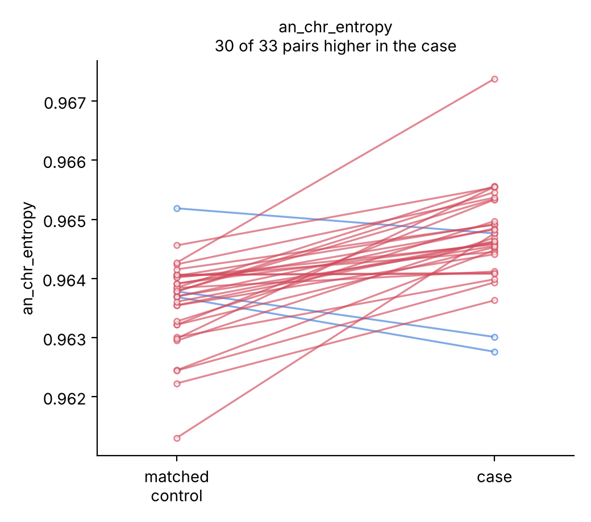

# cfDNA-Insight

Can cancer-associated cfDNA be distinguished from non-cancer cfDNA using genomic and fragmentomic features, and how much of the measured performance survives proper validation?

On 33 matched case-control pairs: chromosomal imbalance separates them, fragment length does not. A two-feature aneuploidy proxy (AUC 0.866) outperforms a 1,193-feature model (0.849). The end-motif block scores highest at 0.899 but drops to 0.593 once chromosome entropy is partialled out, so it is not an independent signal.

## Data

[Zenodo 6914806](https://zenodo.org/records/6914806), CC-BY-4.0. The independent validation cohort from Zhou, Zheng, Fu et al., *Genome Medicine* 2022 (CRAG). Fragment coordinates only, which is why it is openly downloadable.

25 breast and 8 liver cancer patients, each with a control matched on age, sex, smoking and alcohol use. hg19, 11.7-45.2M fragments per sample, roughly 1-3x WGS.

Per Supplementary Table 2, each pair's case and control went through the same library-prep and sequencing batch (5 batches, Cabat1-5). Batch is therefore not confounded with label. This is unusual for public cfDNA data and is the main reason this cohort was used.

`data/README.md` has the download procedure and the sample ID mapping. FinaleDB would have supplied a second cohort but its API was returning 500s.

## Results

Nested CV, 5 outer x 4 inner folds, 10 repeats, ridge logistic regression.

| Feature block | Features | AUC | Band |
|---|---:|---:|---|
| End motifs (4-mer, 5' ends) | 256 | 0.899 | 0.881-0.919 |
| Aneuploidy proxies | 2 | 0.866 | 0.822-0.898 |
| All biological | 1193 | 0.849 | 0.814-0.895 |
| CNV arm z-scores, global reference | 44 | 0.835 | 0.786-0.864 |
| CNV arm z-scores, fold-safe reference | 44 | 0.680 | |
| DELFI short/long profile | 530 | 0.625 | 0.524-0.684 |
| Technical covariates (negative control) | 3 | 0.533 | 0.474-0.596 |
| Fragment size summary | 10 | 0.500 | 0.436-0.569 |
| Fragment size histogram | 351 | 0.462 | 0.360-0.523 |

Full model AUC 0.849, permutation p = 0.005 (200 permutations, which is the floor). Sensitivity 0.70 at 95% specificity. Leave-one-cancer-type-out 0.824; trained on breast and tested on liver, 0.969.

An in silico dilution series puts a limit of detection on the aneuploidy signal: see below.

The band is the spread across CV repartitions, not a sampling confidence interval. The true interval at n=66 is wider.

### Fragment size

Size summary 0.500, size histogram 0.462, DELFI 0.625. DELFI is unchanged by depth adjustment (0.629), so this is not a coverage artefact.

The per-feature paired test is the clearer statement. Within the 33 matched pairs, every fragment-size feature splits near evenly:

| Feature | Case higher in | p |
|---|---:|---:|
| size_median | 14/33 | 0.94 |
| size_mean | 17/33 | 0.60 |
| size_iqr | 11/33 | 0.48 |
| frac_below_150 | 13/33 | 0.48 |
| frac_below_120 | 15/33 | 0.74 |
| frac_167_181 | 15/33 | 0.76 |
| short_long_ratio_global | 15/33 | 0.55 |
| periodicity_10bp | 13/33 | 0.27 |
| motif diversity score | 13/33 | 0.37 |
| **an_chr_entropy** | **30/33** | **3e-07** |

This is not "the classifier failed to find a size signal". No size feature differs between a case and its own matched control.

The DELFI short/long ratio (Cristiano et al. 2019) is the standard feature in this area, and the matching here controls age, sex, smoking, alcohol and batch directly rather than adjusting for them. It still returns nothing.

Possible reasons, which these data cannot distinguish:

- 1-3x coverage may be too low for stable per-window short/long ratios
- the cohort is early-stage (9 Stage IA, 9 Stage IIA of 25 breast)
- `delfi_profile` z-scores within sample, which discards the global size shift. That is a choice made here to remove pre-analytical variation (see `docs/methodology.md`) and it may be discarding signal along with it.

### Aneuploidy

`an_chr_entropy` is the normalised Shannon entropy of per-chromosome fragment proportions. It is higher in the case than in the matched control in 30 of 33 pairs (Wilcoxon p = 3e-07). With `an_coverage_cv` it gives AUC 0.866 on two features.

The paired test is the stronger evidence here, and it is stronger than the AUC: a signed test over 33 matched pairs makes no use of the between-sample variance that a small-n AUC is hostage to. Age, sex, smoking, alcohol and batch are all matched within pair, so none of them explain the difference. Neither feature uses a reference panel, so neither can leak across CV folds.



Each line is one matched pair. The group distributions overlap almost completely (medians 0.9646 vs 0.9638); the pairing is what separates them.

### End motifs

0.894 raw, 0.593 after residualising on chromosome entropy.

4-mers are read off the reference at fragment termini. Arm-level gains and losses redistribute coverage across sequence contexts with different base composition, which shifts the 4-mer spectrum without any change in nuclease activity. Treat the motif block as a second measurement of copy number, not as an additional modality.

## Limit of detection

Synthetic mixtures of one cancer donor's plasma into their own matched
control's, at known ratios, rescored with a model trained on the other 64
donors. Donor MAL1246 (liver, stage 1b) into MAL1246m, 5M fragments per
mixture, 5 replicates per level.

Subsampling to 5M reproduces both features to the sixth decimal against the
donors at full depth (45M and 12M), so the mixtures are faithful.

| fraction of cancer plasma | 0 | 0.05 | 0.10 | 0.25 | 0.50 | 1.0 |
|---|---:|---:|---:|---:|---:|---:|
| chromosome entropy | 0.96377 | 0.96386 | 0.96393 | 0.96425 | 0.96462 | 0.96546 |
| model score | 0.494 | 0.496 | 0.498 | 0.509 | 0.519 | 0.546 |

Two numbers come out of this, and they say different things.

**Against a population threshold, LOD95 is 1.0**: the mixture is not flagged
at any dilution. Taken alone that reads as a failure.

**Chromosome entropy is linear in mixing fraction, R² = 0.998**, slope
1.68e-03 per unit fraction, with a replicate SD of 4.6e-05, about 3% of the
span. So it is not failing to track tumour content. It tracks it precisely.

What limits it is that this donor's whole case-control difference spans 28% of
the chromosome-entropy range across the cohort. Person-to-person variation is
several times the size of a stage-1b tumour's effect, so a threshold set on
other people's samples is the wrong instrument. Against the same donor's own
baseline the limit is **0.08 plasma fraction at 3 SD**.

That is the difference between screening a stranger and monitoring a patient,
and here it is a factor of twelve.

Three caveats, in order of how much they matter.

This is **one donor pair**. The LOD is a single measurement, not a cohort
estimate, and running the other liver pairs would give a range rather than a
point.

**Linearity is weaker evidence than it looks.** Mixing two samples that differ
in any feature produces a linear response in that feature by construction.
R² = 0.998 says the series resolves the mixture cleanly; it does not
independently confirm that the feature tracks cancer. The cohort-level paired
test does that.

The second aneuploidy feature makes the point concrete. `an_coverage_cv` is
also linear here (R² = 0.996) and gives a lower own-baseline LOD, 0.065, but
its slope is *negative* for this donor while cases exceed controls in 23 of 33
pairs cohort-wide. MAL1246 is one of the discordant pairs on that feature, so
its LOD measures resolution rather than detection, and the README quotes the
entropy figure only. `03_dilution_lod.py` compares each slope against the
cohort direction and warns when they disagree.

Finally, replicate spread captures sampling noise in the mixture, not
extraction, library prep or batch, so 0.08 is optimistic for a real
longitudinal assay.

## Validation details

**Negative control.** A model trained only on technical covariates (fragment count, log count, median MAPQ, fraction of empty bins) reaches 0.533, p = 0.37. Depth is null within pairs (48% of 33, p = 0.34).

An earlier version of this block also contained chromosome entropy and bin-coverage dispersion, which are copy-number readouts rather than library metrics, and it scored 0.886. They have been moved to the `aneuploidy` block. `tests/test_pipeline.py` asserts that nothing matching `entropy` or `coverage_cv` can reappear in the technical block.

**CNV reference panel.** Fitting the healthy coverage reference across all healthy samples gives 0.835; rebuilding it inside each training fold gives 0.680. At n=16 the same comparison is 0.963 vs 0.786. Each test-fold healthy sample is roughly 1/n of the reference it is scored against. Use `--cnv-fold-safe` to compute both.

**Mediator adjustment.** Residualising on chromosome entropy raises fragment size from 0.489 to 0.713 and size histogram from 0.442 to 0.765. These increases are artefacts: the negative control also rises (0.507 to 0.606), and removing aneuploidy cannot reveal library signal. Aneuploidy is downstream of the label, so partialling it out conditions on a mediator. Decreases in that column are informative, increases are not. `04_confounder_audit.py` checks for this using the negative control.

**Pairing.** Table S2 states that `MAL####m` is the matched control for `MAL####`. `00_check_pairing.py` confirms it from the fragment files: exact coordinate overlap between paired samples matches the unrelated-sample baseline (median ratio 1.0 over 8 liver pairs), so they are different people. The check uses coordinates only, never fragment length.

## Scope

- Starts from fragment coordinates, not FASTQ. No alignment, so alignment parameters cannot be varied here.
- No somatic variant calling. At 1-3x it would not be meaningful, and clonal haematopoiesis would confound it at any depth without a matched buffy coat.
- No tumour fraction estimate. The CNV module produces arm-level z-scores against a healthy panel. It is not ichorCNA.
- One cohort, one protocol. Cross-cohort generalisation is untested and the pipeline refuses to report a number for it. Leave-one-cancer-type-out shares lab, protocol and batches, so it tests transfer across tumour type only.
- The learning curve has not converged (0.861 at n=52, 0.835 at n=66).
- Retrospective case-control. At screening prevalence the 95%-specificity operating point would produce far more false positives than true ones.

`docs/limitations.md` has the rest, with what would fix each.

## Running it

```bash
conda env create -f environment.yml && conda activate cfdna-insight
pip install -e ".[dev,full]"

python scripts/00_smoke_test.py                      # 2 min, no downloads
bash   scripts/00_fetch_data.sh                      # hg19 + ENCODE blacklist
bash   scripts/00_fetch_crag.sh all                  # 14.3 GB
python scripts/00_extract_metadata.py --xlsx <Additional file 1>.xlsx
python scripts/00_build_samplesheet.py
python scripts/00_check_pairing.py --raw data/raw/crag/liver

python scripts/01_extract_features.py --samples config/samples.tsv \
    --outdir results/features --fasta data/ref/hg19.fa --genome hg19
python scripts/02_train_evaluate.py --features results/features \
    --outdir results/full --cnv-fold-safe
python scripts/04_confounder_audit.py --features results/features
```

The smoke test runs everything on simulated fragment files so a broken environment fails in two minutes instead of three hours into a real run. Its numbers mean nothing; the simulator plants the effect it then finds.

Feature extraction takes about 13 s/sample, so 15 minutes for all 66.

## Layout

```
notebooks/           01 cohort and QC, 02 fragmentomics, 03 modelling
                     (committed with outputs, so they render on GitHub)
src/cfdna_insight/   io, bins, fragmentomics, cnv, features, modeling,
                     dilution, plots, simulate
scripts/             00 smoke/fetch/metadata/samplesheet/pairing,
                     01 features, 02 evaluate, 03 dilution, 04 audit
config/              config.yaml, samples.tsv, samples_by_cancer_type.tsv
tests/               64 tests, simulated data only, no downloads
docs/                project notes, methodology, biological background,
                     limitations
results/             summary.json, confounder_audit.json, figures, tables
```

All AUCs above reproduced to three decimals on macOS/arm64 and Linux/x86-64.

## License

Code is MIT. The data is CC-BY-4.0 and should be cited as Zhou, Zheng & Liu (2022) along with the CRAG paper. `data/raw/` is gitignored.

## References

Zhou, Zheng, Fu et al., *Genome Medicine* 2022 (CRAG). Cristiano et al., *Nature* 2019 (DELFI). Snyder et al., *Cell* 2016. Jiang et al., *Cancer Discovery* 2020. Adalsteinsson et al., *Nature Communications* 2017 (ichorCNA).
